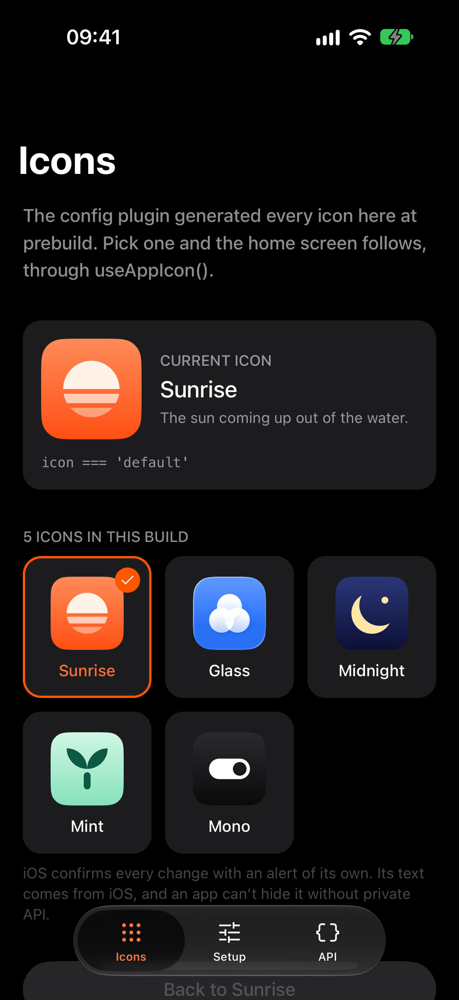
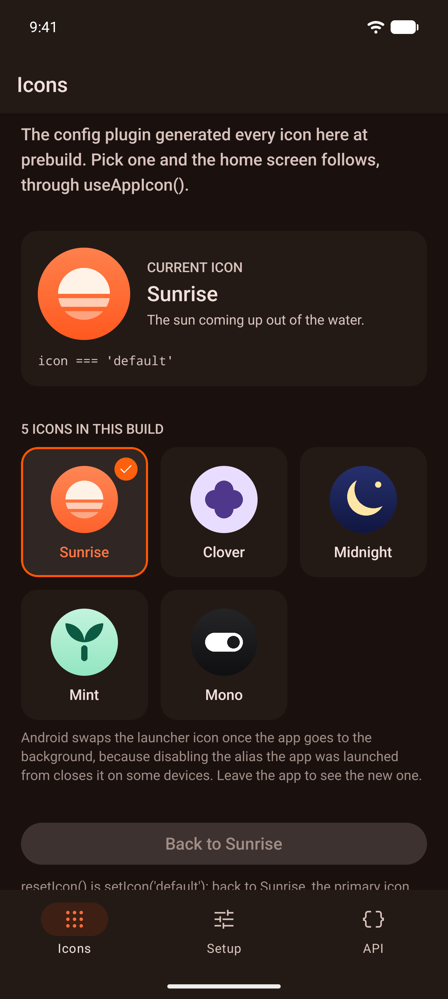

# expo-app-icons

[](https://www.npmjs.com/package/@hzblj/expo-app-icons)
[](./LICENSE)

Alternate app icons for Expo on iOS and Android. A config plugin generates the icons at prebuild, from PNGs with dark and tinted appearances or Icon Composer documents on iOS and adaptive layers on Android, and a native module switches between them at runtime.

<p>
  
  
</p>

```sh
npx expo install @hzblj/expo-app-icons
```

```ts
// app.config.ts
plugins: [
  ['@hzblj/expo-app-icons', {
    icons: {
      midnight: {
        ios: {light: './assets/midnight.png', dark: './assets/midnight-dark.png'},
        android: {foregroundImage: './assets/midnight-foreground.png', backgroundColor: '#0B1035'},
      },
    },
  }],
]
```

```ts
import {AppIcon, useAppIcon} from '@hzblj/expo-app-icons'

await AppIcon.setIcon('midnight')

const {icon, icons, setIcon, resetIcon} = useAppIcon()
```

**[Documentation](./packages/expo-app-icons/README.md)**: the plugin's options for both platforms, the API and platform behavior.

## This repository

| Path | What lives there |
| --- | --- |
| `packages/expo-app-icons/` | `@hzblj/expo-app-icons`, the published package: the JavaScript API, the config plugin and the iOS and Android module |
| `apps/example/` | The example app: a family of icons drawn for it, a picker over `useAppIcon()`, each icon's configuration, iOS appearances and Android layers, and the `AppIcon` API live |

```sh
yarn                 # install
yarn prebuild        # build the package, then a clean `expo prebuild` of the example
yarn ios             # run the example on iOS (dev client); `yarn android` for Android
yarn start           # Metro for the example
yarn test            # the config plugin's tests
yarn lint            # Biome and TypeScript
yarn pack:check      # pack the package as npm gets it, run its plugin and type-check a consumer
yarn changeset       # describe a change for the next release
```

## More libraries

The other libraries from the same author are at **[libraries.janblazej.dev](https://www.libraries.janblazej.dev)**.

## Sponsorship

<a href="https://www.buymeacoffee.com/hzblj"></a>

## License

MIT © Jan Blazej
